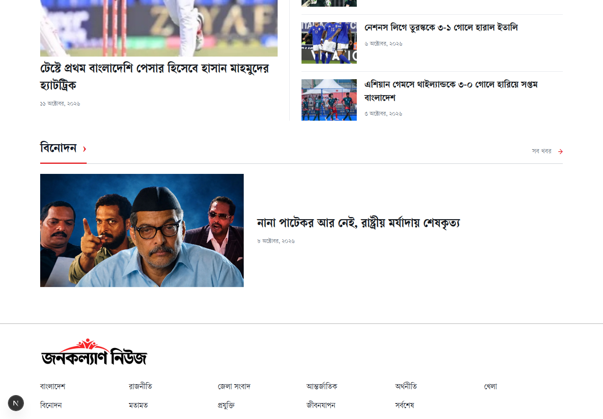

# জনকল্যাণ নিউজ · Jonokolyan News

A Bengali news website with tenant-specific articles, category pages, audio news, AI summaries, and date archives.

## Run locally

Use Node.js 20.9 or later. The project was checked with Node.js 24.

```bash
npm ci
cp .env.example .env.local
npm run dev
```

Open [localhost:3000](http://localhost:3000).

## Backend connection

The site uses the separate Django `newspaper` backend. Configure these server-side variables:

```env
NEWS_API_BASE_URL=https://newspaper-web-production.up.railway.app
NEWS_TENANT_SLUG=jonokolyannews
```

Every news request sends the configured `X-Tenant-Slug` header. The backend supplies the menu categories, published news, article summaries, audio files, videos, and ads. An internet connection is required for the hosted backend and remote media. Empty categories show an empty state; sample stories do not replace failed requests.

## Features

- Bengali category navigation and responsive news sections.
- Article pages with audio playback, speed controls, and collapsible AI summaries.
- Native video playback and supported YouTube embeds.
- Search, author and date filters, district news, and calendar archives.
- Saved articles, sharing, and reading-size controls.
- Public ad slots with view and click tracking.

The print and English pages show availability notices because their backend content is not yet supplied.

## Main routes

| Page | Route |
| --- | --- |
| Home | `/` |
| Category | `/category/[slug]` |
| Article | `/news/[slug]` |
| Search and latest news | `/archive`, `/search` |
| Today's news | `/newstoday` |
| Date calendar | `/archive-calendar` |
| Photos and video | `/photostory`, `/tube` |

See [the page and API map](docs/PUBLIC_API_MAP.md) for request details and tenant setup.

## Checks and production build

```bash
npm test
npm run lint
npm run build
npm start
```

`npm start` serves the production build. This app needs a Node.js host because it fetches data on the server and provides a public API proxy.

## Project files

- `src/app/`: pages, styles, and API proxy.
- `src/components/`: header, footer, story layouts, and media controls.
- `src/lib/`: backend requests, category links, and content formatting.
- `public/`: publication images, icons, and Bengali fonts.
- `tests/`: data and integration contract tests.
- `docs/`: API notes and design review previews.

## Design preview



[Mobile preview](docs/design-review/section-mobile.png). These design review captures show earlier published content; current stories depend on the selected backend tenant.

The site uses Next.js, React, Tailwind CSS, and Lucide icons. Publication assets and local fonts are included as supplied with this project. News images and media remain subject to their source owners' rights. This repository does not grant a separate reuse license for those assets.
